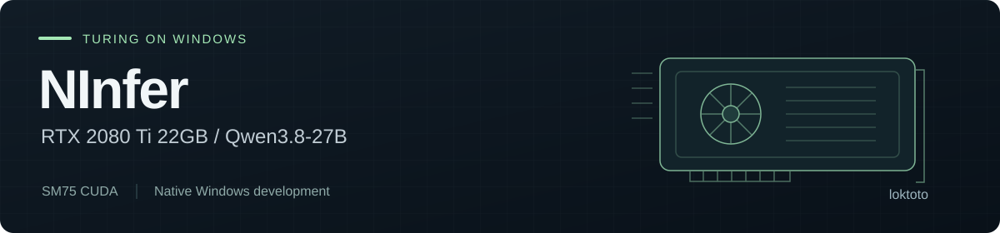

# NInfer for RTX 2080 Ti 22GB on Windows (CUDA SM75)



**Experimental local LLM inference with Qwen3.8-27B on a modified Turing card. Developed and maintained by [loktoto](https://github.com/loktoto).**

I'm adapting [NInfer](https://github.com/Neroued/ninfer) for my RTX 2080 Ti 22GB and a native Windows workflow: build the CUDA runtime, install a verified package, and serve a local API. Work here covers SM75 kernels, VRAM use, Windows tooling and the tests needed to trust the result.

> 呢個係我自己維護嘅 2080 Ti 22GB / Windows 移植專案。已經做到原生安裝同基本推理；長文本、tool calling 同 MTP 仲有驗收未過，會跟實測結果繼續修。

[Latest recorded GPU tests](https://github.com/loktoto/ninfer-rtx-2080ti-22gb-windows/blob/windows-native-sm75/docs/WINDOWS-SM75-LOCAL-VALIDATION.md) · [Project status](docs/PROJECT-STATUS.md) · [Documentation](docs/README.md) · [Releases](https://github.com/loktoto/ninfer-rtx-2080ti-22gb-windows/releases)

## Where development stands

**Experimental. No production release is published as of 26 October 2026.** The latest tracked native Windows report records tests on 12–13 October; it is evidence for that tested package, rather than a pass for every later change.

| Recorded result | Status |
|---|---|
| Native build, package verification and clean Windows installation | Passed |
| Installed Base API, streaming, authentication and short 8K-capacity smoke | Passed |
| Semantic retrieval near 8K, required tool call and greedy MTP0/MTP3 parity | Failed |
| Follow-up SM75 MMA fragment correction | Four standalone dense-oracle cases passed on the physical GPU |
| Replacement runtime, full attention/model acceptance and production release | Pending in the tracked report |

The [full report](https://github.com/loktoto/ninfer-rtx-2080ti-22gb-windows/blob/windows-native-sm75/docs/WINDOWS-SM75-LOCAL-VALIDATION.md) keeps the original failures and follow-up investigation together. A short smoke test does not establish long-context quality. MTP, tool calling, Vision and compressed KV need their own evidence; 128K remains experimental.

## Branches and target

| Branch | Contents |
|---|---|
| [`master`](https://github.com/loktoto/ninfer-rtx-2080ti-22gb-windows/tree/master) | SM75 source baseline, including the opt-in RK4V4E8 KV path and its validation tools |
| [`windows-native-sm75`](https://github.com/loktoto/ninfer-rtx-2080ti-22gb-windows/tree/windows-native-sm75) | Native Windows/MSVC runtime, installer, launchers, artifact/toolchain locks and package acceptance |

The Windows profile targets **Windows 10/11 x64, compute capability 7.5 and at least 20,000 MiB of detected VRAM**. A stock 11GB RTX 2080 Ti does not meet that profile. The pinned runtime requires an NVIDIA R580-or-newer driver and the Microsoft Visual C++ x64 runtime.

The work builds on NInfer's C++/CUDA engine and OpenAI/Anthropic serving interfaces. My focus is the Turing implementation and a usable Windows installation, with Base text mode as the starting point. Features and measurements inherited from other GPUs are not qualification for this card.

## Native Windows development

Use the Windows branch for native builds:

```powershell
git clone --branch windows-native-sm75 https://github.com/loktoto/ninfer-rtx-2080ti-22gb-windows.git
cd ninfer-rtx-2080ti-22gb-windows
.\install\bootstrap-developer-windows-sm75.ps1
```

The bootstrap provisions the pinned developer toolchain and starts the build with frontend and physical GPU regressions. Read the [native build guide](https://github.com/loktoto/ninfer-rtx-2080ti-22gb-windows/blob/windows-native-sm75/docs/windows-sm75.md) before running it. Build and GPU checks require their documented prerequisites; they are separate from package-bound production acceptance.

For an existing locked developer setup, the recorded follow-up command is:

```powershell
.\scripts\build-windows-sm75.ps1 -WholeProgramCuda -RunFrontendRegression -RunW8Regression -RunAttentionRegression
```

The intended end-user path is a checksummed ZIP, complete extraction and `START-HERE.bat`. The packaged runtime does not require Python, Visual Studio or the CUDA Toolkit. Until a qualified release is available, use the [installation guide](https://github.com/loktoto/ninfer-rtx-2080ti-22gb-windows/blob/windows-native-sm75/docs/INSTALL-WINDOWS-SM75.md) as development documentation.

## Linux / WSL2 source baseline

Build `master` with CMake 3.28+, CUDA 12.8+, Ninja, a C++20 compiler, pkg-config, FFmpeg development libraries and libcurl development libraries. Exact dependency versions are checked in [CMakeLists.txt](CMakeLists.txt).

```bash
git clone https://github.com/loktoto/ninfer-rtx-2080ti-22gb-windows.git
cd ninfer-rtx-2080ti-22gb-windows
cmake -S . -B build -G Ninja \
  -DCMAKE_BUILD_TYPE=Release \
  -DCMAKE_CUDA_ARCHITECTURES=75
cmake --build build -j
```

This builds the CLI and server. Use an artifact compatible with the checked-out branch; the Windows v2 lock below is specific to the native Windows channel. See the [CLI guide](docs/cli.md), [serving guide](docs/serving.md) and [SM75 validation runbook](docs/sm75-2080ti-validation-runbook.md) for the relevant commands.

## Pinned Windows model

The native Windows channel uses **Qwen3.8-27B / groupwise-int / container v2**. Model weights are downloaded separately from the runtime package.

| Field | Pinned value |
|---|---|
| Publisher | [neroued/Qwen3.8-27B-NInfer](https://huggingface.co/neroued/Qwen3.8-27B-NInfer) |
| Revision | `3526913004b1cf552cb57b88d6a5c6f5e4a89a70` |
| File | `qwen3_8_27b.ninfer` |
| Bytes | `18,210,531,328` |
| SHA-256 | `eec39564993d6e9c7d5e383382a760f093465c9d163ec9a1bd6b80199514bf3e` |

The [artifact lock](https://github.com/loktoto/ninfer-rtx-2080ti-22gb-windows/blob/windows-native-sm75/config/windows-sm75-artifacts.json) is authoritative. Do not replace this file with the publisher's latest revision: a newer container can require a different reader.

## Local API

The Windows launcher starts Base mode at `http://127.0.0.1:8080/v1`. The installer stores its generated API key under the installation's `secrets` directory. Use `/health` for readiness and authenticated `/v1/models` for the actual model ID.

Use that ID in OpenAI-compatible clients. Keep the key out of shared settings and logs. The built-in listener uses plain HTTP; follow the [security policy](SECURITY.md) for remote access. See [serving](docs/serving.md) for endpoints and request formats.

## Tests, contributions and credit

Start with the [documentation index](docs/README.md), [tests](tests/README.md), [benchmarks](bench/README.md) and [contributor guide](CONTRIBUTING.md). Report the branch, hardware, model and command behind a result. Release acceptance must cover the exact ZIP on the physical 22GB card, including semantic retrieval, tool calls and deterministic MTP parity.

I maintain this fork's SM75 and Windows changes under [loktoto](https://github.com/loktoto). **NInfer was originally developed by [Neroued](https://github.com/Neroued/ninfer).** Original authorship and notices are preserved under [Apache-2.0](LICENSE); see [NOTICE](NOTICE.md). Models retain their publishers' licenses.

Use this repository's [pull requests](https://github.com/loktoto/ninfer-rtx-2080ti-22gb-windows/pulls) for changes and non-sensitive development discussion. Older PR references in development records belong to the earlier `loktoto/ninfer-2080ti-22g` repository. For vulnerabilities, follow [SECURITY.md](SECURITY.md).
